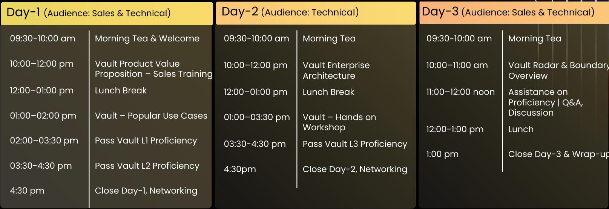

# HashiCorp Vault

## 260929 

### Vault Product Value Proposition - Sales Training

- 세일즈에 중점을 맞춘 세션
- HashiCorp Cloud Platform의 주요 제품
  1. Infra의 life cycle 관리(build, deploy) - Terraform
    - `Terraform을 이용해 ~32%의 cloud spend를 줄였다`
  2. Security life cycle 관리 - HashiCorp Vault
  3. `Vault, Boundary, Consul`로 구성되어있다
- 3개의 목표
  1. Vault의 비즈니스 가치와 유즈 케이스(비즈니스 케이스)
  2. 더 깊은 기술적 정보에 대해
  3. 주요 기능에 대한 실습과 컨설팅 방법

#### IT, Complexity and Security Evolution

- 이전에는 security가 그렇게 큰 문제가 아니였다(적은 규모의 네트워크)
- internet이 나오면서 생산성이 늘어나고, security가 문제가 되기 시작했다
- 그리고 현재는 AI로 인해 security의 문제가 급격히 증가했다
- 현재 클라이언트들이 가장 걱정하는 보안은?
  - hybrid multi-cloud/ AI & AI agents/ Quantum Computing
    - 특히 이 부분 보안에 대해 미래 계획이 준비가 제대로 되어있는지 다시 한번 전략을 검증해야한다
  - 이전의 보안은 경계였지만, 이제는 내부에 들어오더라도 핵심 데이터의 가시성을 얻지 못하게 하는 것이 중요하다
- cloud가 증가함에 따라 공격할 수 있는 지점이 증가하고있다
  - 현재는 너무 중요한 앱들이 너무 많은 곳에 분산이 되어있다
- 이전에는 사람이였다면, 현재는 인간이 아닌 인증이 너무나도 많다(약 45배)
  - API Keys, Tokens, Agents(non-human)
  - Consumers, Employees(human)
  - 특히 요즘 앱들에는 수많은 AI agent들이 존재해서 이들의 인증/인가 관리가 어렵다
- 많은 기업들이 이들을 다르기 위한 인증/인가 방법을 사용하지만 이는 인간이 사용하기 위한 것이라 문제가 될 수 있는 부분이 많다
  - AI agent는 비결정론적이기 때문에 문제가 될 수 있는 부분이 특히나 많다
  - 이전에 발생했던 openAI의 sandbox를 탈옥한 예시가 있다
  - 이런 문제들은 아이덴티티, 클라우드, 제로 트러스트 보안에 대한 기업의 투자를 가속화하고있다

#### 현재의 복잡한 보안 환경을 해결 가능한 솔루션, HashiCorp Vault

- Vault는 큰 access 권한을 주지 않는다
  - Zero-Trust 구현 가능, 최소 권한 구축 가능
  - ttl을 가진 실시간 인증을 발행함으로써 유출시 위험을 최소화한다
  - exposure도 식별 가능하다(Vault Radar를 이용한 scan)
- IBM Vault의 기능
  1. Centralize secrets
  2. control access(who can access what & how long)
  3. generate dynamic secrets
  4. rotate secrets dynamically
  5. encryption As a Service(Transit encryption)
  6. Auditing & logging
- Vault를 왜 써야하는가?
  1. reduce risk of breaches(and massive financial cost)
  2. Compliance & auditing
  3. Developer productivity(faster GTM)
  4. Fast, safe scalability of services
  5. Reduce operational costs
  6. Protect critical business assets
  7. Vendor & cloud flexibilty
  8. Reduced incident impact & recovery time (kill switch의 존재)
- `Head of platform team, platform operations team, and Chief Information Security Officer(CISO)`이 주된 고객이다
- 그래서 수익은 어디서 발생하는가?
  - 분산된 secret, 중앙화된 것이 없어 audit이 불가능하다
  - 많은 프로그래머들이 하드코딩을 한다
  - 인증서를 수동으로 관리한다
  - API key가 몇개나 있나요? 라는 물음에 답하기 어렵다
- Identity-based Security이기에 비밀 자격에 관한 것들을 모두 보호 가능하다
- Fully Managed는 HashiCorp Cloud Platform을 사용하며, Self-Managed는 Vault Enterprise를 사용한다
- Cyberark의 limitaion은 `Complex Integrations, Scaling bottlenecks, Missing key feautres`(Vault의 가장 큰 경쟁사)
- CIO/CISO/DevOps는 서로 다른 것을 추구해서 충돌한다
  - Identity가(Vault) 통제의 중심이 되면, 이들은 협력이 가능하다
- ideal Customer Profile - Key Signals 어떤 사람이 고객이 될 수 있는가?
  - Identify the maturity level of the customer in cloud adoption
    - `Adoption, Standardizing, Scaling`
    - Adoption: 여러 클라우드를 사용해보며 서비스를 올려보고, 채택하는 단계
    - Standardizing: 이를 사용해서 적응하는 단계
    - Scaling: ROI를 보는 성숙도가 높은 단계
    - 단계에 따라 Vault를 제안하는 방법이 달라질 수 있다
  - Actively deploying or planning AI agents (co-pilots, automation, agentic-workflows / 없다고 말하더라도 해당 방향으로 말을 이어가면 이미 사용하는 경우가 많다)
  - Regulated industry: financial services, healthcare, life sciences, gov.
    - 이런 규제 사업들은 70%가 vault를 사용하고 있다
  - Security team and dev team oprationg independently with no shared observability
  - Using multiple secrets managers, key vaults, or certificate stores
    - 너무 많은 비밀 관리를 하다보면 문제가 생기게되어, 비밀 저장소가 필요해진다
- 비밀의 자동화가 핵심 가치이다
  - secrets & keys management
  - 특히나 agentic AI Identify & access management에 많이 사용된다
  - certificate management
  - data encryption & proteciton

### Let's Dive into Use-Cases of Vault (Nalini Dayma)

#### Why our Customer love vault

1. secrets & keys management
2. 특히나 agentic AI Identify & access management에 많이 사용된다
3. certificate management
4. data encryption & proteciton
- Reason why Customers adopt Vault
  - `is Regulatory Compliance`
    - 각 나라마다 특유의 규제들이 있고, 이를 해결하기 위한 방법은 Vault이다(K-FSI, K-PIPA, MSA(Medical Service Act))
    - 규제 -> vault의 해결방법
    - Key Management, Data Encryption -> Encryption-as-a-service
    - Key-Data Separation -> Centralized Key Custody
    - Privileged Access Control -> Least-Privilege Secrets
    - API & Third-Party Risk -> Machine-to-Machine trust
    - Audit & Forensics -> Full Traceability
- RBAC을 code로 만들 수 있어서 이를 빠르게 피드백 가능하다

#### Centralized Secret

- 시스템에서 사용하는 application이 많고, 이에 해당하는 secret들은 너무 많아 여러 곳에 분산되어 존재하게 된다
- Vault Rader를 이용해 관리되지 않은 secret을 스캔 가능하다(`Ent | SaaS only`)
  - commit history까지 추적이 가능하다
  - code의 line도 추적 가능하며, risk의 수준도 정할 수 있다
  - pr시 scan하며, 비밀이 있다면 거부된다
  - 전체적인 CI pipeline을 안전하게 가져갈 수 있다
- KV static & Dynamic Secret Engine
  - Store, Generate, Rotate & Expire Secrets
  - 자격을 즉시(JIT) 만든다
  - TTL을 지정할 수 있다
  - 비상 상황시 즉시 정지할 수 있다
  - 다양한 인증 지원가능
- Secrets Sync & Secrets Import Engine(`Ent | SaaS only`)
  - 동적 자격증명을 만들어낼 수 있다(Cloud, Database ..)
    - vault에 요청을 통해 자격증명을 만들어낼 수 있다
  - Multi tenancy의 경우 namesapces를 통해 해결 할 수 있다
- Cretificate Management
  - 복잡한 인증서 관리가 문제가 되는 경우가 많다
  - 47일마다 인증서를 rotate 시키면 사람의 실수는 나올 수 밖에 없다
  - n일마다 인증서의 rotate를 vault가 자동화 한다
  - vault agent를 통해서 해당 기능을 사용할 수 있다(ACME를 사용하면 vault agent없이 진행 가능)
  - Root CA + Intermediate CA 가 될 수도있으며, Intermediate CA with 3rd party root CA가 될 수도 있다
    - 이 경우 모든 인증서를 vault에서 관리할 수 있다
- Data Protection & Encryption
  - 신용카드, 결제정보, 이메일 같은 개인 식별정보를 저장한다면 이는 규제에 따라야하고 이는 vault가 해결 가능하다
    - Encryption/Decryption
    - Encode/Decode, Data masking
    - Key Management
  - Transform Secrets Engine(`Ent | SaaS only`)
    - Tokenization -> 암호화(c@2492asd)
    - Format Preserving Encryption(FPE) -> 같은 스키마로 암호화 (1111-2222-3333-4444 -> 5412-1241-1255-1245)
    - Data masking -> 마스킹 (1111-2222-3333-4444 -> ************4444, 마스킹 후 원복이 불가능하다, e.g.로그를 암호화하는 경우 사용)
    - 암호화한 상태가 필요할 때 사용(?)
    - 사람이 읽을 필요가 있을때
  - Transit Secret Engine - Cryptographic Encryption/Decryption
    - 대량데이터 암/복호화(volume이 gb단위로 매우 큰 경우 사용한다)
    - 형식이 상관 없는 경우
    - 패킷 캡쳐 등 민감 정보가 암호화가 필요할 경우 사용한다
    - 사람이 읽을 필요가 없을때
- Securing Containerized Workloads (Kubernetes, AWS EKS, Google EKS)
  - k8s secrets stored etcd default(암호화 되지 않고 저장됨)
    - etcd 접근 권한이 있다면 모두 접근이 가능함
  - kubernetes secrets engine을 사용한다
    - rbac, ttl 모두 사용 가능
    - authentication을 통해 kubernetes의 비밀에 접근 가능
      - authentication 이후 진행 방법
      - option1. sidecar agent injector를 통해 주입시킨다(k8s native는 아닌 방법)
      - option2. vault secrets operator(VSO) for k8s & redhat openshift
        - vault사용법을 몰라도 사용가능한 방법이며, vault를 k8s가 관리해서 사용 가능하다(k8s native Helm Chart 사용)
- Agentic AI Identity & Access Management(new)
  - 사람이 사용한다면 user만 사용한다고 생각하기 쉽지만, 매일 사용하는 것을 모두 생각해보면 다양한 것을 사용한다
    - certification, vm, pod secret .. 등 다양한 agentic identity가 필요하다
  - 가장 큰 문제는 volume이 크다는 것이다
    - 유출이 되더라도 이를 인지하기까지의 시간이 오래걸린다
  - 사람이라면 지문이나 얼굴인식 등 다양한 방법이있지만, 기계는 어떤 인증 방법이 있는지에 대한 문제가 생긴다
  - NHI에 대한 저장, 취소에 대한 문제
  - Enabling Runtime Agentic AI Security(`Ent | SaaS Only`)
    - Agent Registry
      - agent 의 identity를 등록하는 기능
    - Agent IAM with IBM Verify
      - IBM Verify와 Integration
      - Auth0, Okta 등 인증 방법과 연동
    - Vault MCP Server
      - Configuration을 돕는 MCP server이며, bootstrap을 더 쉽게 만들어줌

## 260930

- 암호화된 자료 쿼리시, transform 사용(transit을 사용하면 안됨, 이메일/휴대전화번호/식별번호 등 패턴이 있기 때문)
  - transform사용시 패턴에 따라서 쿼리가능
  - transit은 규정 준수를 위해, 간단한 연산일 경우만
- vault에 많은 encry/decryp 요청이 필요할 경우는?
  - vault에 rate limit이 존재해, 이를 사용해 과도한 요청에 대한 rate limit을 설정 가능하다
  - 암호화 request를 bulk로 보내는 방법도 있음
- key rotation
  - key rotation시 이전 key는 어떻게 되는가?: vault안에 old, new 모두 존재한다 / old key 도 vault가 인식해 사용해준다
- high availability, vault outage
  - primary vault가 일시적으로 사용할 수 없다면 failover시킨다(secondary(disastor recovery) cluster 사용)
  - 자동으로 failover 기능은 없고, 설정이 필요하다
  - cloud 서비스의 경우 자동으로 설정됨

### Vault Enterprise Architecture(Nalini Dayma)

- Community에서 사용 못하는 availability and performance 기능을 사용할 수 있다(멀티 클러스터 구성 가능, HA 사용 가능 Stanby cluster)

#### Vault architecture

- Vault의 클라이언트
  - vault에 인증하는 모든 주체
  - e.g) human(bob@example.com)으로 통해 인증, non-human(mywebapp@app-ns42, k8s)으로 인증
  - authentication methods
    - human auth: GitHub, LDAP, JWT, Okta, username & password, Microsoft Entra
    - machine auth: AppRole, AWS, Azure, Google Cloud, JWT, Kubernetes, RADIUS, TLS Certificates
  - governance - via role based access policies(deny by default - no policy = no authorization)
    - read only policy, admin policy 등 권한 설정 가능
    - policy는 hcl file을 통해 선언형으로 만들기 떄문에 수동으로 추가할 필요가 없다
- vault secret
  - information you consider sensitive & want to protect/encrypt/limit access & exposure.
- seal concepts
  - SasS 사용시 이 개념을 이해해야한다
  - 처음 설치시 vault는 sealed 되어있어, master key가 없다
  - master key는 vault의 memory에 저장되고, 인간 사용자는 이 master key를 볼 수 없다
  - manual unseal
    - unseal하기 위한 master key는 admin에게 나눠 가지고 있다
    - 모든 사람의 키를 모아 master key로 unseal을 할 수 있다
    - 이런 manual unseal은 권고하지 않는다
  - auto unseal
    - Clod Provider or HSM storage를 통해 가져와서 진행된다
- vault agent
  - k8s의 sidecar
    - client daemon, provides automatic autentication
    - 서버를 대신해서 agent가 vault의 secret을 읽는다
    - e.g.1. side car agent in k8s namespace
    - e.g.2. automatic certificate fetching & rotation on target server

#### Enterprise Reference Architecture Guide

- Vault Enterprise(Self-Managed) / HCP Vault Dedicated(SaaS, Fully managed on HashiCorp Cloud Platform) 두가지 형태로 존재
  - cloud, SaaS가 사용 불가능한 기업은 Vault Enterprise를 사용
  - HCP Vault는 AWS, Azure에서 사용 가능
- Enterprise는 cluster 구성이 기본
  - leader server에서만 write 가능
  - read replica는 read only, write 요청시 leader로 포워딩
  - read replica추가로 read 확장 가능
  - vault의 내부통신은 8201 port, 일반 API Request는 lb를 통해 8200 port로 전달됨
- cluster 구성의 경우 api request 분배를 위한 lb가 지원된다
  - application 내부의 통신의 lb는 현재 지원되지 않는다
- cloud의 특징
  - cloud의 경우 auto scaling이 지원된다
  - active-standby로 구성되며, 각 지역별로 replication 되어 master가 sync된다
  - token과 leases 들은 복제되지 않는다
    - config와 key만 복제된다
  - 지역마다 policy가 다를 수 있으니, 설정을 해서 특정 policy의 sync를 막을 수 있다
- Replication type
  - Disaster Recovery Replication
    - Primary - Secondary
    - bussiness의 연속성을 위해서
  - Performance Replication
    - US cluster - EU cluster
      - reduce latency, additional cluster closer request
      - GDPR 규정 준수를 위해 사용된다
- Automate Vault install & config with terraform
  - vault provides official terraform modules to automate vault ent installation
  - vault에 가이드가 있음(AWS, Azure, GCP)
  - k8s는 helm chart로 사용 가능
  - docker의 경우 docker hub에 vault-enterprise 이미지도 존재

## 261001

- Lab2,3 진행
